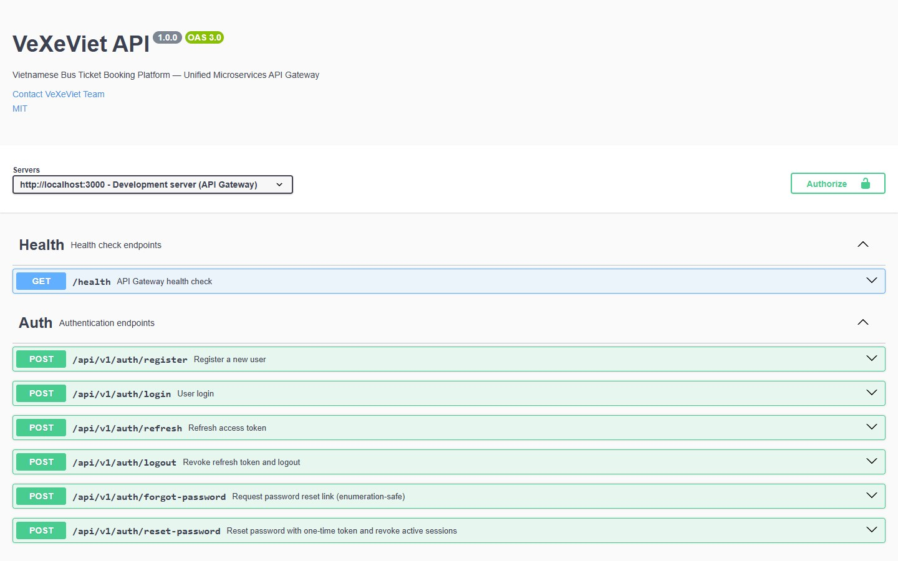

# VeXeViet Backend (`vexeviet-be`)

Kho mã nguồn Backend Microservices trên nền Turborepo cho hệ thống đặt vé xe khách liên tỉnh **VeXeViet**. Hệ thống tách bạch 4 miền nghiệp vụ cốt lõi (`user`, `route`, `booking`, `payment`) đứng sau một cổng `api-gateway` thống nhất, đồng thời hỗ trợ chế độ đóng gói hợp nhất một tiến trình (`scripts/start-unified.js`) để vận hành gọn nhẹ trên hạ tầng container đám mây.

## Liên kết hệ thống Demo & API trực tuyến

| Thành phần | Đường dẫn trực tuyến | Hạ tầng vận hành |
| :--- | :--- | :--- |
| **API Gateway gốc** | https://vexeviet-api-8752.onrender.com | Render Docker Container |
| **Kiểm tra trạng thái (`Health Check`)** | https://vexeviet-api-8752.onrender.com/health | Express API Gateway |
| **Tài liệu OpenAPI 3.0 (Swagger UI)** | https://vexeviet-api-8752.onrender.com/api/docs | Swagger UI trực tuyến |
| **Ứng dụng Đặt vé hành khách (`vexeviet-fe`)** | https://vexeviet-web.vercel.app | Vercel Edge Network |
| **Cổng Quản trị & Nhà xe (`vexeviet-fe`)** | https://vexeviet-admin.vercel.app | Vercel Edge Network |

### Tài khoản kiểm thử trên dữ liệu Production (69.447 bản ghi)

Cơ sở dữ liệu trên **TiDB Cloud Serverless** đã nạp sẵn `5.000` người dùng (`2` quản trị viên, `25` hãng xe khách thực tế kèm ảnh trên Cloudinary, `4.973` hành khách), `3.518` chuyến xe và gần `10.000` đơn đặt vé cùng lịch sử thanh toán:

| Vai trò | Email đăng nhập | Mật khẩu | Phạm vi quyền hạn |
| :--- | :--- | :--- | :--- |
| **Quản trị viên (`ADMIN`)** | `admin@vexeviet.com` | `Admin@123456` | Toàn quyền quản trị hệ thống, đối soát thanh toán, quản lý người dùng |
| **Đối tác Nhà xe (`OPERATOR`)** | `phuongtrang@vexeviet.com` | `Password@123` | Quản lý tuyến xe, đơn vé, doanh thu và kho ảnh của riêng nhà xe |
| **Hành khách (`CUSTOMER`)** | `customer@vexeviet.com` | `Password@123` | Tìm chuyến, giữ ghế, đặt vé và gửi đánh giá chuyến đi |

---

## Giao diện Tài liệu API & Ứng dụng kết nối

**Cổng tài liệu tương tác OpenAPI 3.0 (`/api/docs`)**


**Giao diện Ứng dụng Hành khách và Cổng Quản trị kết nối trực tiếp tới Backend**

| Tìm kiếm chuyến xe (`apps/web`) | Dashboard vận hành (`apps/admin`) |
| :---: | :---: |
|  |  |

---

## Kiến trúc dịch vụ và Cấu trúc thư mục

```text
vexeviet-be/
├── apps/
│   └── api-gateway/        # (:3000) Điều phối /api/v1/*, CORS, giới hạn tần suất, OpenAPI (/api/docs), gắn X-Request-Id
├── services/
│   ├── user-service/       # (:3001) Xác thực JWT/Refresh, Người dùng, Nhà xe, Sơ đồ ghế mẫu, Tải ảnh Cloudinary, Audit Logs
│   ├── route-service/      # (:3002) Quản lý tuyến xe, Tìm kiếm hành trình có bộ đệm Redis, Thống kê nhà xe
│   ├── booking-service/    # (:3003) Giữ ghế có khoá thời gian, Đặt vé, Thống kê Dashboard, Đánh giá chuyến đi
│   └── payment-service/    # (:3004) Cổng thanh toán VNPay, Webhook IPN, Hoàn tiền, Đối soát lệch trạng thái
├── packages/
│   ├── config/             # (@vexeviet/config) Kiểm tra biến môi trường bằng Zod và chuẩn hoá địa chỉ nội bộ
│   ├── common/             # (@vexeviet/common) AppError, nén Gzip JSON, Logger gắn RequestId, RBAC, kết nối Redis TLS
│   └── database/           # (@vexeviet/database) Lược đồ Prisma MySQL, 9 bản migration, quản lý Pool và tự động thử lại kết nối
├── scripts/
│   ├── start-unified.js    # Khởi chạy cả 4 service và API Gateway trong một tiến trình Node.js duy nhất (~160 MB RAM)
│   └── harvest-operator-images.mjs # Thu thập và đẩy bộ ảnh thực tế của 25 nhà xe lên Cloudinary CDN
├── docs/                   # Tài liệu kiến trúc, đặc tả API và cẩm nang triển khai Cloud
├── tests/                  # Bộ kiểm thử tích hợp Postman và kiểm thử tải k6
├── Dockerfile              # Đa tầng (multi-stage) trên node:20-alpine cho môi trường Cloud Container
└── render.yaml             # Cấu hình Render Blueprint triển khai tự động tại vùng Singapore
```

### Hạ tầng đám mây đang sử dụng
- **Tính toán (`Compute`)**: Render Docker Web Service kết hợp quy trình kiểm tra định kỳ trên GitHub Actions (`keep-alive.yml`).
- **Cơ sở dữ liệu (`Database`)**: TiDB Cloud Serverless (tương thích MySQL 8.0 qua kết nối TLS, cấu hình sẵn bộ chỉ mục kết hợp và kết nối dùng chung).
- **Bộ nhớ đệm (`Cache`)**: Upstash Redis qua giao thức `rediss://` có bật TLS SNI.
- **Lưu trữ đa phương tiện (`Media CDN`)**: Cloudinary lưu trữ ảnh đại diện người dùng, biểu trưng nhà xe và ảnh nội/ngoại thất phương tiện với biến đổi định dạng tự động `f_auto,q_auto`.
- **CI/CD & Bảo mật**: GitHub Actions kiểm tra `ESLint`, `TypeScript`, `Unit Tests`, quét bí mật rò rỉ bằng `Gitleaks`, kiểm tra Dockerfile bằng `Hadolint`, quét lỗ hổng bằng `Trivy` và xuất bản image lên `GHCR`.

---

## Khởi chạy môi trường phát triển (`Local Dev`)

```bash
pnpm install
cp .env.example .env
pnpm docker:up        # Khởi động MySQL 8 (:3306) và Redis 7 (:6379) dưới máy trạm
pnpm prisma:generate  # Sinh mã nguồn Prisma Client
pnpm build            # Biên dịch các gói dùng chung (@vexeviet/config, common, database)
pnpm db:seed:5k       # (Tuỳ chọn) Nạp bộ dữ liệu quy mô 5.000 người dùng và 25 nhà xe
pnpm dev:services     # Chạy đồng thời API Gateway (:3000) cùng 4 dịch vụ (:3001..3004)
```

### Kiểm tra chất lượng mã nguồn

```bash
pnpm lint             # Kiểm tra quy tắc ESLint toàn monorepo
pnpm type-check       # Kiểm tra kiểu tĩnh TypeScript
pnpm test             # Chạy toàn bộ Unit Tests
```

---

## Chuẩn phản hồi lỗi và Truy vết `X-Request-Id`

Mọi yêu cầu đi qua `api-gateway` đều được cấp mã định danh `X-Request-Id` xuyên suốt tới từng dịch vụ đích. Khi phát sinh lỗi, toàn bộ dịch vụ trả về một cấu trúc JSON thống nhất:

```json
{
  "success": false,
  "error": {
    "code": "VALIDATION_ERROR",
    "message": "Thông báo lỗi chi tiết",
    "details": []
  },
  "requestId": "9f82a1c0-4b1e-4d9a-8c2a-1d3e5f7a9b0c"
}
```

## Tài liệu hướng dẫn chuyên sâu

- [Lưu trữ ảnh Cloudinary, sinh dữ liệu 5.000 người dùng và triển khai Cloud miễn phí](docs/guides/CLOUD-MEDIA-SEEDING-DEPLOYMENT.md)
- [Khởi tạo dữ liệu mẫu cơ bản](docs/guides/DATABASE-SEEDING.md)
- [Triển khai hệ thống trên Kubernetes](docs/architecture/K8S-DEPLOYMENT.md)
